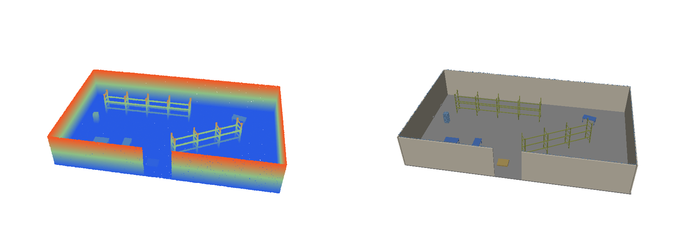
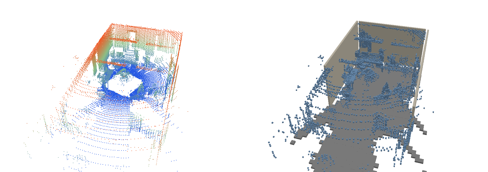
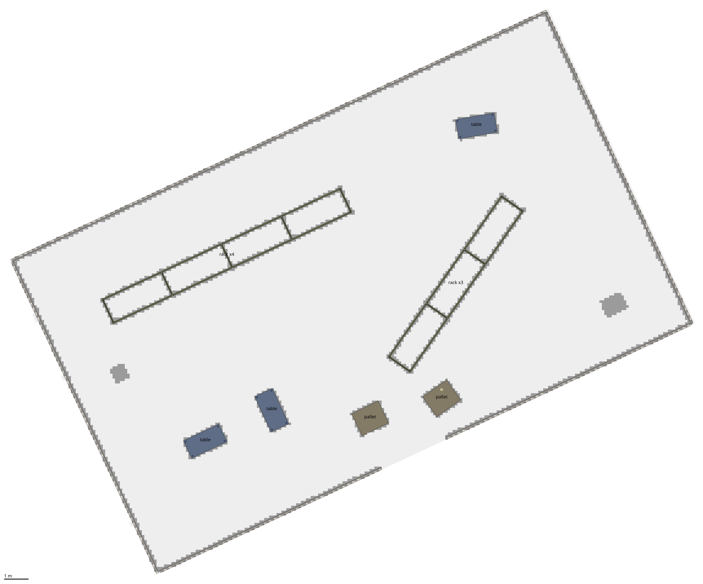

# pcd2scene

Reconstruct a simulation scene from a point cloud map: floor, walls and catalogued objects (racks, tables, pallets) become parametric collision geometry, everything else becomes a voxel mesh, exported as URDF, SDF (Gazebo) and USD (Isaac Sim) from one scene description.

pcd2scene 把點雲地圖還原成模擬場景。地面、牆與物件目錄裡的設備換成有尺寸、有類別的參數化幾何；其他沒辦法辨識的點轉成體素網格。三種格式從同一份場景描述 `scene.json` 產生，座標慣例與欄位定義見 [docs/spec.md](docs/spec.md)。



## 快速開始

```bash
git clone https://github.com/wicanr2/pcd2scene.git && cd pcd2scene
harness/run.sh all
```

`harness/run.sh` 會檢查環境、安裝、跑測試，再跑兩個示範並逐條驗收，結果寫在 `out/harness-summary.json`。有 docker 時在容器裡執行；沒有 docker 時用 Python 3.11 以上建 `.venv`（`--native`）。給 AI agent 與 CI 的完整說明在 [AGENTS.md](AGENTS.md)。

還原自己的點雲：

```bash
harness/run.sh setup
.venv/bin/python -m pcd2scene build my_map.pcd -c my_config.yaml -o out/my_map   # native 模式
```

或安裝成指令：`pip install .[usd]`，之後用 `pcd2scene build ...`。

## 示範

### PCL 房間掃描

Point Cloud Library 的 `room_scan1.pcd`（BSD-3-Clause），一間開向走廊的辦公室，11 萬點。執行時下載並核對 SHA-256，不放在本 repo。



| 項目 | 結果 |
| --- | --- |
| 地面 | 輸入傾斜 1.04 度，轉正後在 z = 0 |
| 天花板 | 離地 2.95 m（預設不輸出，避免擋住俯視） |
| 牆 | 3 面；第四側是走廊開口 |
| 家具 | 彼此相連、沒有固定尺寸，留在殘餘網格 |
| 覆蓋率 | 輸入點離場景表面 5 cm 內 93.1%，10 cm 內 100% |
| 時間 | 2.3 s（4 CPU） |

### 合成倉庫

`pcd2scene synth` 產生的 24 m x 14 m 倉庫：四面牆（含門口）、兩排貨架（其中一排轉 30 度）、三張桌子、兩個棧板、兩個未登錄的箱子，整體再加上 0.9 度傾斜、25 度旋轉與平移。附真值，可以逐項比對。

| 項目 | 結果 |
| --- | --- |
| 地面 | 真值地面四角還原後離 z = 0 最多 0.2 mm |
| 牆 | 5/5，中心誤差最大 7.7 cm（只看到內側面，牆盒用預設厚度 0.1 m，真值是 0.2 m），方向誤差 0.12 度內 |
| 貨架 | 2/2，格數 4 與 3 正確，自動偵測的層板高度 1.02、2.02 m（真值 1.0、2.0 m） |
| 桌子、棧板 | 3/3、2/2；所有目錄物件的中心誤差 6 mm 內、方向誤差 1 度內 |
| 未登錄的箱子 | 留在殘餘網格 |
| 覆蓋率 | 5 cm 內 99.1%，10 cm 內 99.99% |

俯視總覽（`overview.svg`）：



## 輸出

| 檔案 | 內容 |
| --- | --- |
| `scene.json` | 場景描述：座標變換、元素、零件，[規格](docs/spec.md)與 [JSON Schema](schema/scene.schema.json) |
| `scene.urdf` | 靜態場景，`check_urdf` 驗證 |
| `scene.sdf` | Gazebo world（SDF 1.9），`gz sdf -k` 驗證 |
| `scene.usda` | Isaac Sim 可直接載入，含碰撞 API，USD `UsdValidation` 驗證 |
| `meshes/residual.stl` | 殘餘網格 |
| `report.json` | 覆蓋率與距離統計 |
| `overview.svg`、`preview.png` | 俯視總覽與 3D 預覽 |

場景座標的地面在 z = 0。要疊回原始地圖座標（例如定位地圖），匯出時加 `--frame input`，根節點會帶反變換。

## 物件目錄

重複擺放的設備寫成目錄，pcd2scene 依尺寸辨識並換成標準模型：

```yaml
objects:
  catalog:
    - class: rack
      size: [2.7, 1.1, 3.0]          # 單元長、寬、高
      array: {pitch: 2.7}            # 一排相連的貨架還原成 n 格
      model: {type: rack, levels: auto}
    - class: pallet
      size: [1.2, 1.0, 0.15]
      model: {type: box}
```

模型類型有 `box`、`table`、`rack` 與外部 STL 的 `mesh`。全部欄位見 [docs/config.md](docs/config.md)，演算法與門檻的由來見 [docs/pipeline.md](docs/pipeline.md)。

## 限制

- 掃不到的面不會補；被擋住一半的物件對不上目錄，會落到殘餘網格。
- 放滿貨物的貨架正面可能被當成牆，要調 `walls.min_fill` 或分區處理。
- 輸入要大致 z 朝上（10 度內），否則用 `input.transform` 先轉。
- 外部網格只收二進位 STL。

## 授權

Apache-2.0，見 [LICENSE](LICENSE)。示範資料的來源與授權見 [NOTICE](NOTICE)；`docs/images/room_scan_preview.png` 由 PCL 的 `room_scan1.pcd` 渲染。
