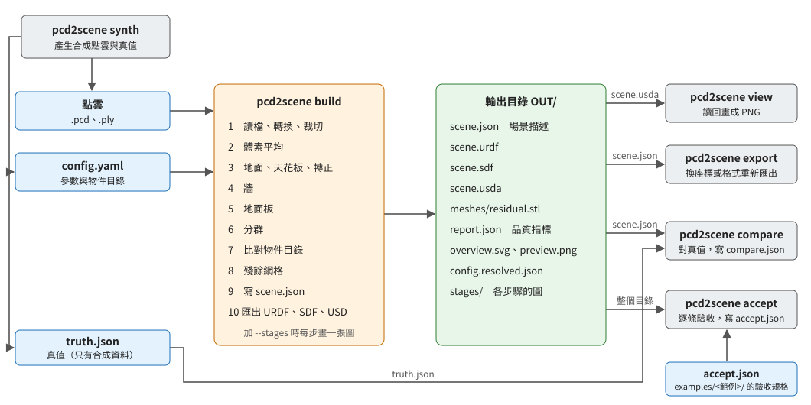

# 指令與檔案

pcd2scene 有七個子指令。`build` 把點雲變成場景，其餘指令負責準備輸入、檢查輸出或換格式。下圖是指令之間靠哪些檔案串起來：



文中的範例輸出是在本 repo 根目錄實際執行的結果（合成倉庫，種子 0），換一台機器跑也會相同。安裝方式見 [README](../README.md#快速開始)；native 模式把 `pcd2scene` 換成 `.venv/bin/python -m pcd2scene`。

| 指令 | 輸入 | 輸出 | 結束碼 |
| --- | --- | --- | --- |
| `synth OUT` | 無 | `OUT/<版面>.pcd`、`truth.json`、`catalog.yaml` | 0 |
| `info CLOUD` | 點雲檔 | 終端機印 JSON | 0 |
| `build CLOUD -c CONFIG -o OUT` | 點雲檔、設定檔 | 輸出目錄 `OUT/` | 0；`OUT` 不是空的且沒加 `--force` 時 2 |
| `view FILE -o PNG` | `scene.urdf`、`scene.sdf` 或 `scene.usda` | PNG | 0 |
| `export OUT/scene.json` | `scene.json` | 同目錄的 `scene.urdf`、`scene.sdf`、`scene.usda` | 0 |
| `compare SCENE TRUTH` | `scene.json`、`truth.json` | 終端機的 PASS／FAIL；`--out` 另寫 JSON | 0 PASS，1 FAIL |
| `accept OUT SPEC` | 輸出目錄、驗收規格 | 終端機的逐條結果；`--json` 另寫 JSON | 0 ACCEPT，1 REJECT |

程式出錯（讀不到檔、設定欄位拼錯）時印出 Python 例外並以 1 結束。

## synth：產生合成點雲

```bash
pcd2scene synth out/tutorial/data                   # 倉庫
pcd2scene synth out/office/data --layout office     # 辦公室
```

```text
wrote out/tutorial/data/warehouse.pcd (436132 points), truth.json, catalog.yaml
```

| 選項 | 預設 | 意義 |
| --- | --- | --- |
| `--layout` | `warehouse` | `warehouse` 或 `office` |
| `--seed` | 0 | 取樣與雜訊的亂數種子 |
| `--spacing` | 0.04 | 表面取樣間距（m） |
| `--noise` | 0.01 | 高斯雜訊的標準差（m） |

輸出三個檔：

| 檔案 | 內容 |
| --- | --- |
| `warehouse.pcd` 或 `office.pcd` | 二進位 PCD，欄位 x、y、z。整個場景加了傾斜、旋轉與平移，模擬地圖座標和重力方向不一致 |
| `catalog.yaml` | 可直接給 `build -c` 的設定：物件目錄，辦公室版另有預覽角度 |
| `truth.json` | 真值，給 `compare` 用 |

`truth.json` 的座標是合成時的場景座標（地面 z = 0），欄位如下：

| 欄位 | 內容 |
| --- | --- |
| `layout` | `warehouse` 或 `office` |
| `floor_extent` | 地面範圍 `[xmin, xmax, ymin, ymax]` |
| `ceiling` | 天花板高度；倉庫沒有天花板，是 null |
| `walls` | 每面牆的 `center`（x、y）、`yaw`、`length`、`thickness`、`height` |
| `objects` | 每個目錄物件的 `class`、`center`、`yaw`、`units`（格數），貨架與書架另有 `levels` |
| `unknown` | 不在目錄裡的箱子：`center`、`size` |
| `T_input_from_truth` | 4x4，把真值座標轉到點雲檔的座標，也就是合成時加上的傾斜、旋轉與平移 |
| `seed`、`spacing`、`noise` | 產生時的參數 |

## info：檢查點雲讀得對不對

```bash
pcd2scene info out/tutorial/data/warehouse.pcd
```

```json
{
 "file": "warehouse.pcd",
 "sha256": "1ea468311316a5636ca63e6ff7c04de4ee8786d1942a69e9b4be69eeb1332bcc",
 "points_raw": 436132,
 "points_finite": 436132,
 "min": [-1.574, -15.586, 0.676],
 "max": [26.16, 7.32, 5.107],
 "intensity": false
}
```

`points_raw` 是檔頭宣告的點數，`points_finite` 是去掉 NaN、無限大之後的點數。`min`、`max` 是原始座標範圍，可以用來決定 `input.crop`。這個倉庫的 z 從 0.676 開始，因為合成時整體往上移了 0.9 m 又加了傾斜。`intensity` 表示檔案有沒有強度欄位，pcd2scene 讀進來但不使用。

## build：還原場景

```bash
pcd2scene build out/tutorial/data/warehouse.pcd -c out/tutorial/data/catalog.yaml -o out/tutorial/scene --stages
```

| 選項 | 意義 |
| --- | --- |
| `-c CONFIG` | 設定檔，見 [config.md](config.md)。省略時全用預設值，不比對物件目錄 |
| `-o OUT` | 輸出目錄。已存在且不是空的會拒絕，要覆寫加 `--force` |
| `--formats urdf,sdf,usd` | 只輸出部分格式，覆蓋 `export.formats` |
| `--frame scene\|input` | 匯出座標，覆蓋 `export.frame`，見 [spec.md](spec.md#單位與座標) |
| `--stages` | 另把每一步畫成圖，放在 `OUT/stages/` |
| `--no-preview` | 不畫 `preview.png` |

執行時的 log（不含 `--stages` 那一行）：

```text
points: raw 436132, finite 436132, voxel 366350
floor: 179112 points, tilt 0.944 deg, height at centroid 0.901
  wall candidate rejected: length 10.90 top 2.86 fill 0.26 upper 0.26 contact True
  wall candidate rejected: length 10.88 top 2.88 fill 0.25 upper 0.25 contact True
  wall candidate rejected: length 8.19 top 2.88 fill 0.26 upper 0.26 contact True
  wall candidate rejected: length 8.19 top 2.87 fill 0.27 upper 0.26 contact True
walls: 5
  unmatched cluster at (2.82, -7.41): 0.56 x 0.55 x 1.41 m, 1490 points, on_floor True
  unmatched cluster at (23.02, -4.60): 0.86 x 0.65 x 0.92 m, 1505 points, on_floor True
objects: pallet 2, rack 2, table 3
residual: 3656 points -> 20732 triangles
coverage: 0.05 m 1.000, 0.1 m 1.000; elements: {'floor': 1, 'pallet': 2, 'rack': 2, 'residual': 1, 'table': 3, 'wall': 5}
wrote out/tutorial/scene: scene.json, overview.svg, report.json, scene.urdf, scene.sdf, scene.usda, preview.png
```

| 行 | 意思 |
| --- | --- |
| `points` | 檔頭點數、有限值點數、體素平均後的點數 |
| `floor` | 地面平面的內點數、相對 +z 的傾角、地面在點雲中心處的高度（輸入座標） |
| `wall candidate rejected` | 被拒絕的牆候選：長度、頂高、填滿率、上半部填滿率、是否碰到天花板。`upper` 只供判讀，不參與判斷。調 `walls.*` 時主要看這幾行 |
| `walls` | 接受的牆數 |
| `unmatched cluster` | 沒對上目錄的叢集：中心（場景座標）、長寬高、點數、是否落地。要加目錄項目時從這裡抄尺寸 |
| `objects` | 對上目錄的各類別數量 |
| `residual` | 進殘餘網格的點數與三角形數 |
| `coverage` | 輸入點離場景表面 5 cm、10 cm 內的比例，取到小數三位（`report.json` 有四位：0.9997） |

輸出目錄的檔案：

```text
out/tutorial/scene/
├── scene.json              場景描述，其他格式都從它產生
├── scene.urdf              ROS、Gazebo Classic
├── scene.sdf               Gazebo（SDF 1.9）
├── scene.usda              Isaac Sim
├── meshes/residual.stl     殘餘網格，三種格式都引用它
├── report.json             覆蓋率、距離、各類別數量、每個點的歸屬
├── overview.svg            俯視總覽，標類別
├── preview.png             左：輸入點雲；右：還原場景
├── config.resolved.json    預設值合併設定檔之後的完整設定
└── stages/                 加 --stages 才有
    ├── 01_input.png … 11_usd.png
    └── stages.json
```

欄位定義見 [spec.md](spec.md)。這個倉庫的 `report.json`（`support` 欄位省略）：

```json
{"points_evaluated": 366350, "points_excluded": 0,
 "coverage": {"0.05": 0.9997, "0.1": 1.0},
 "distance_m": {"median": 0.0149, "p95": 0.0247, "max": 0.0661},
 "elements": {"floor": 1, "pallet": 2, "rack": 2, "residual": 1, "table": 3, "wall": 5},
 "labels": {"floor": 180701, "object": 30349, "residual": 3656, "wall": 151644},
 "seconds": 14.49}
```

`stages/stages.json` 是每張圖對應的數字，例如第 4 步的牆候選：

```json
"04_walls": {"tall_cells": 4418, "walls": 5, "candidates": [
  {"length": 24.14, "top": 3.92, "fill": 0.99, "accepted": true, "reason": []},
  {"length": 10.9, "top": 2.86, "fill": 0.26, "accepted": false, "reason": ["fill"]}, …]}
```

`reason` 是拒絕的原因：`height`（牆頂不到 `walls.min_height`）、`fill`（填滿率低於 `walls.min_fill`）、`ceiling_contact`（有天花板但牆頂離天花板超過 `walls.ceiling_contact`）。每張圖的意思見 [tutorial.md](tutorial.md)。

## view：讀回匯出的檔案畫成圖

```bash
pcd2scene view out/tutorial/scene/scene.usda -o out/tutorial/usd.png
```

```text
wrote out/tutorial/usd.png: scene.usda, 22136 triangles
```

直接解析 `scene.urdf`、`scene.sdf`（或 `.world`）、`scene.usda`（或 `.usd`、`.usdc`），不讀 `scene.json`，所以畫出來的就是模擬器會載入的盒子、網格與位姿。URDF 依 joint 鏈組合位姿，SDF 依 model、link、visual 的 pose，USD 由 pxr 算每個 prim 的世界座標。三種格式讀回的三角形應該一樣多，數字不同代表匯出有問題。

| 選項 | 預設 | 意義 |
| --- | --- | --- |
| `--width`、`--height` | 900、640 | 影像大小 |
| `--azimuth`、`--elevation` | -55、38 | 相機方位角與仰角（度） |

## export：重新匯出

```bash
pcd2scene export out/tutorial/scene/scene.json --formats urdf --frame input
```

```text
wrote ['scene.urdf']
```

從 `scene.json` 重新產生 URDF、SDF、USD，不重跑還原。常見用法是把場景轉回原始點雲座標（`--frame input`），疊到定位地圖上。輸出寫在 `scene.json` 所在的目錄，會覆蓋同名檔案；要保留原本的檔案，先把整個目錄複製一份再匯出。

| 選項 | 預設 | 意義 |
| --- | --- | --- |
| `--formats` | `urdf,sdf,usd` | 要輸出的格式 |
| `--frame` | `scene` | `scene`（地面 z = 0）或 `input`（原始點雲座標） |
| `--mesh-uri` | `relative` | 網格路徑寫法：`relative`、`file`、`package:<名稱>` |

## compare：對真值

```bash
pcd2scene compare out/tutorial/scene/scene.json out/tutorial/data/truth.json --out out/tutorial/scene/compare.json
```

```text
floor {'max_abs_z_at_corners': 0.0002}; walls 5/5; objects 7/7; extra objects []; extra walls 0
PASS
```

只用在 `synth` 產生的資料。真值先用 `T_input_from_truth` 轉到點雲座標，再用還原得到的 `T_scene_from_input` 轉到場景座標，然後逐項比：

| 項目 | 通過條件 |
| --- | --- |
| 地面 | 真值地面四角轉過來之後離 z = 0 在 3 cm 內 |
| 牆 | 每面真值牆取中心最近的還原牆，中心差 0.2 m 內、方向差 3 度內、長度差 0.4 m 內 |
| 物件 | 每個真值物件都有同類別的元素，中心差 0.2 m 內、方向差 3 度內、格數相同；有層板的再比層數與層高，層高差 0.05 m 內 |
| 天花板 | 真值有天花板時，高度差 0.05 m 內 |
| 多出來的 | `extra objects`、`extra walls` 是沒有對應真值的元素，列出來但不影響結果 |

`compare.json` 逐項記錄誤差，例如 `{"id": "wall_000", "center_err": 0.05, "yaw_err_deg": 0.001, "length": 24.142399, "truth_length": 24.0, "ok": true}`。

## accept：驗收

```bash
pcd2scene accept out/tutorial/scene examples/synth_warehouse/accept.json --json out/tutorial/scene/accept.json
```

驗收規格是一個 JSON，列出必須存在的檔案與每個指標的範圍：

```json
{
  "files": ["scene.json", "scene.urdf", "compare.json", "stages/stages.json"],
  "rules": {
    "compare.pass": {"eq": true},
    "coverage.0.05": {"min": 0.97},
    "count.wall": {"eq": 5},
    "floor.tilt_deg": {"min": 0.9, "max": 1.0},
    "ceiling.height": {"eq": null}
  }
}
```

| 指標 | 來源 |
| --- | --- |
| `coverage.<tol>`、`distance.median`、`distance.p95` | `report.json` |
| `count.<類別>` | 該類別的元素數；沒有這個類別時是 0 |
| `floor.tilt_deg` | 輸入地面相對 +z 的傾角 |
| `ceiling.height` | 天花板離地高度，沒有天花板時是 null |
| `compare.pass` | `compare.json`，只有合成資料有 |

每條規則印一行：結果、指標、實際值、要求。下面是沒加 `--stages` 就驗收的結果，兩個 `stages/` 檔案不存在，所以整體 REJECT、結束碼 1：

```text
PASS  file scene.json           present  (present)
…
FAIL  file stages/stages.json   missing  (present)
FAIL  file stages/11_usd.png    missing  (present)
PASS  compare.pass              True  (eq True)
PASS  coverage.0.05             0.9997  (min 0.97)
PASS  count.wall                5  (eq 5)
PASS  floor.tilt_deg            0.943736  (min 0.9 max 1.0)
PASS  ceiling.height            None  (eq None)
REJECT
```

`--json` 寫出同樣的內容與全部指標，harness 存成 `OUT/accept.json`。

## harness 的檔案配置

`harness/run.sh` 把上面的指令串起來。每個示範的輸入與輸出放在 `out/<示範>/`：

| 命令 | 執行的指令 | 輸入 | 輸出 |
| --- | --- | --- | --- |
| `demo-synth` | `synth`、`build --stages`、`compare`、`accept` | 無 | `out/synth_warehouse/data/`（點雲、真值、目錄）、`out/synth_warehouse/scene/` |
| `demo-office` | 同上，`--layout office` | 無 | `out/synth_office/data/`、`out/synth_office/scene/` |
| `demo-room` | 下載、`build --stages`、`accept` | `data/room_scan1.pcd`、`examples/room_scan/config.yaml` | `out/room_scan/scene/` |
| `demo-room2` | 同上 | `data/room_scan2.pcd`、`examples/room_scan2/config.yaml` | `out/room_scan2/scene/` |

驗收規格一律是 `examples/<示範>/accept.json`。每一步的結果彙整在 `out/harness-summary.json`，格式見 [AGENTS.md](../AGENTS.md)。
