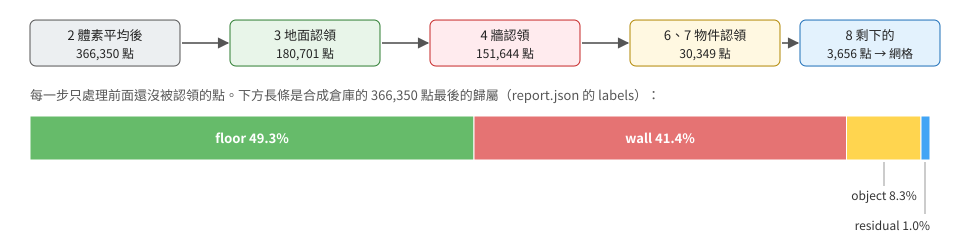
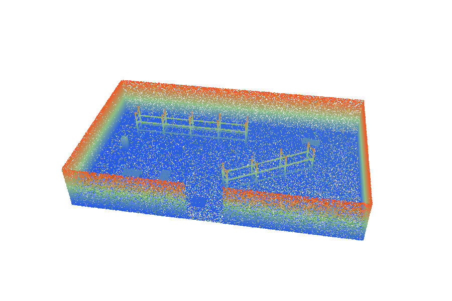
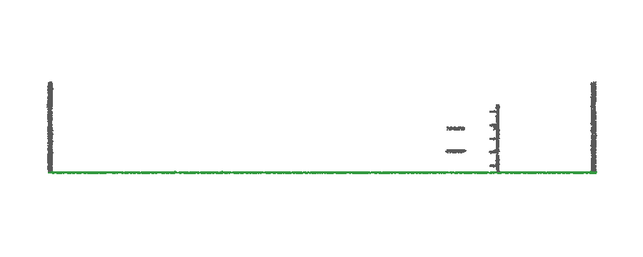
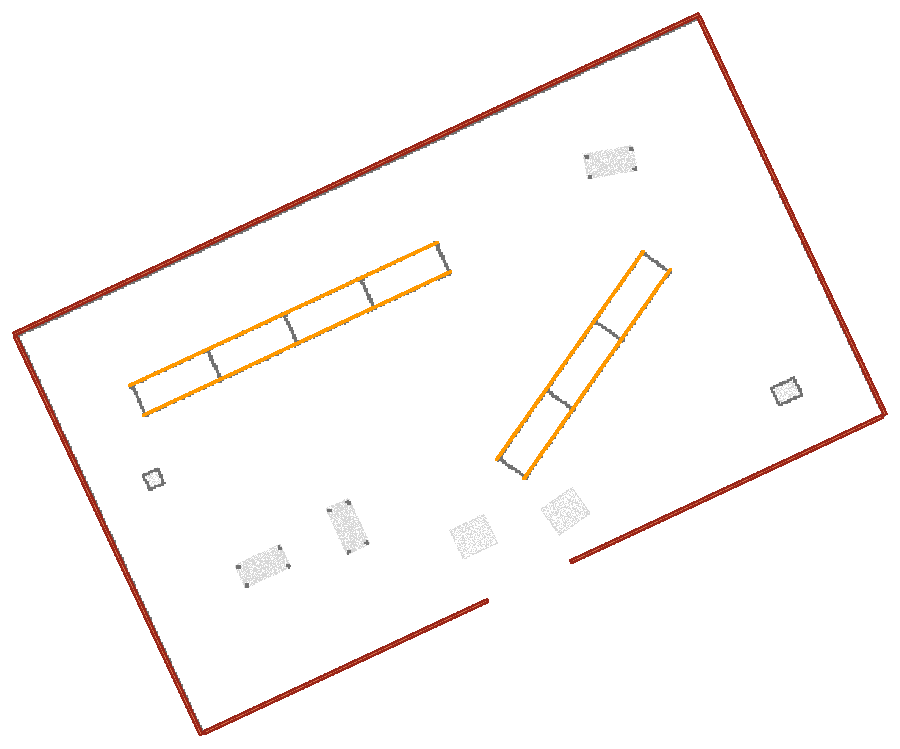
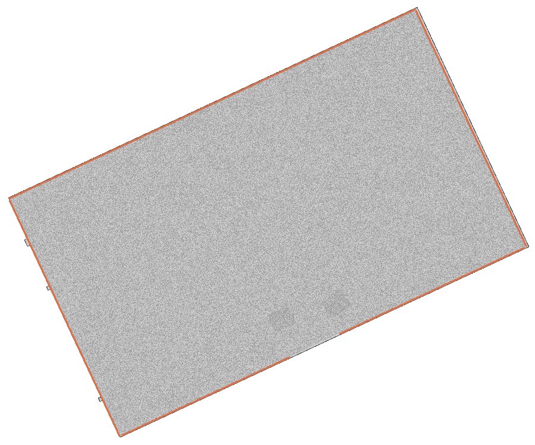
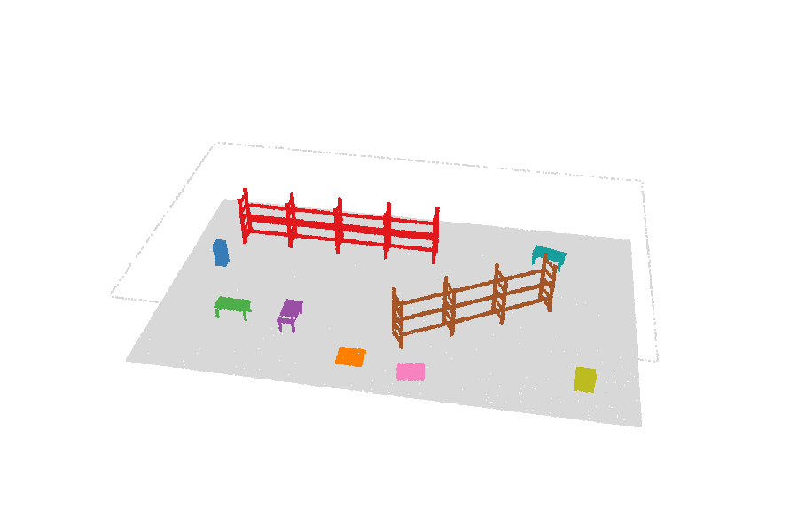
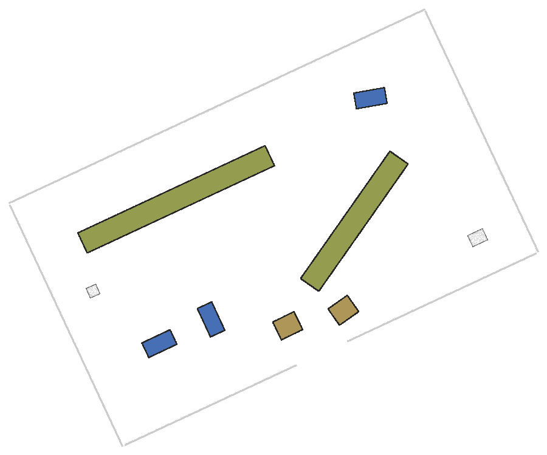
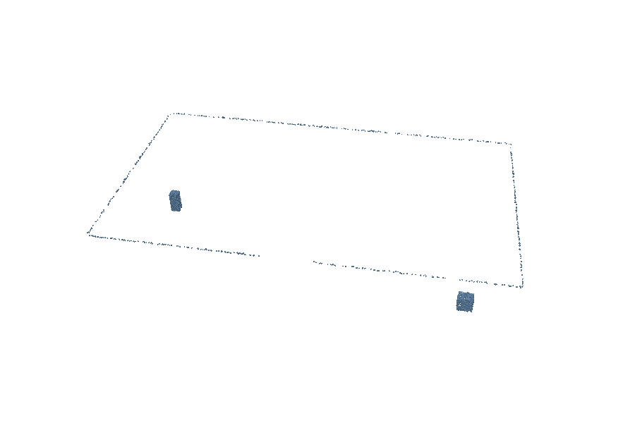
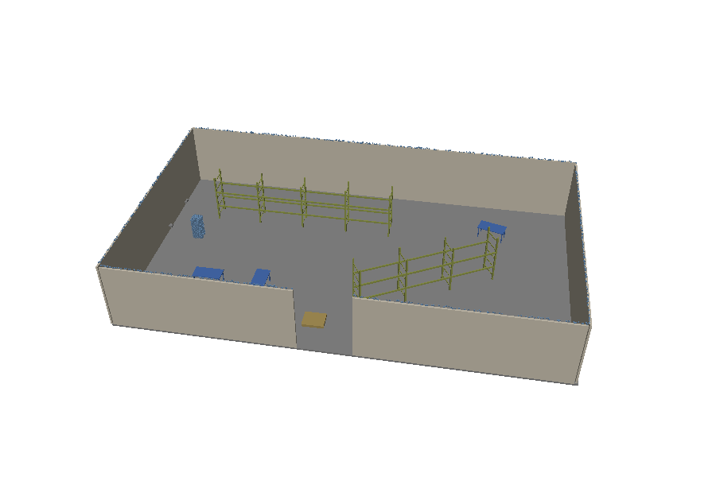

# 逐步教學：從點雲到 URDF、USD

這份教學用合成倉庫走完整個流程。每一步都列出執行的指令、程式做了什麼，以及結果長什麼樣子。另外兩個場景（合成辦公室、PCL 真實房間掃描）用同樣的步驟寫在各自的範例頁，見最後一節。各指令的選項、輸出檔與 log 的意思見 [commands.md](commands.md)，演算法的理由與門檻的由來見 [pipeline.md](pipeline.md)，欄位定義見 [spec.md](spec.md)。

文中的圖都由 `pcd2scene build --stages` 產生，放在輸出目錄的 `stages/`，每步的數字記在 `stages/stages.json`。3D 圖從同一個角度拍，前後可以直接對照。

| 步驟 | 輸入 | 輸出 | 主要設定 | 圖 |
| --- | --- | --- | --- | --- |
| 1. 原始點雲 | 點雲檔 | 點的座標（輸入座標） | `input.transform`、`input.crop` | `01_input.png` |
| 2. 體素平均 | 步驟 1 的點 | 每 3 cm 一個平均點 | `preprocess.voxel` | `02_voxel.png` |
| 3. 地面、天花板、轉正 | 步驟 2 的點 | `T_scene_from_input`、天花板高度；點標上 floor、ceiling | `floor.*`、`ceiling.*` | `03_level.png` |
| 4. 牆 | 還沒標記的點 | 牆元素；點標上 wall | `walls.*` | `04_walls.png` |
| 5. 地面板 | floor 點、最長那面牆的方向 | 地面元素（矩形板） | `floor.cell`、`floor.fill_holes` | `05_floor.png` |
| 6. 分群 | 還沒標記的點 | 叢集 | `objects.cluster_voxel`、`objects.min_points` | `06_clusters.png` |
| 7. 比對目錄 | 叢集、物件目錄 | 物件元素；點標上 object | `objects.catalog`、`objects.unknown` | `07_match.png` |
| 8. 殘餘網格 | 還沒標記的點 | `meshes/residual.stl`、殘餘元素 | `mesh.voxel` | `08_residual.png` |
| 9. 場景描述 | 全部元素與轉換 | `scene.json`、`report.json`、`overview.svg`、`preview.png` | | `09_scene.png` |
| 10. 匯出 | `scene.json` | `scene.urdf`、`scene.sdf`、`scene.usda` | `export.*` | `10_urdf.png`、`11_usd.png` |

第 3 步之後，每一步只處理前面還沒被認領的點。下圖是這個倉庫的點最後分給了誰，對應 `report.json` 的 `labels`：



## 準備

最快的方式是跑 harness，它會產生合成資料、還原、畫出每一步：

```bash
harness/run.sh demo-synth          # 圖在 out/synth_warehouse/scene/stages/
```

要自己一步一步下指令，先建好 native 環境，再依序執行：

```bash
harness/run.sh --native setup
.venv/bin/python -m pcd2scene synth out/tutorial/data
.venv/bin/python -m pcd2scene info  out/tutorial/data/warehouse.pcd
.venv/bin/python -m pcd2scene build out/tutorial/data/warehouse.pcd -c out/tutorial/data/catalog.yaml \
    -o out/tutorial/scene --stages
.venv/bin/python -m pcd2scene view  out/tutorial/scene/scene.usda -o out/tutorial/usd.png
```

`synth` 和 `build` 都固定亂數種子，同一台或不同台機器跑出來的檔案逐位元相同，數字會和本文一致。

## 1. 原始點雲

程式：`io_pcd.read_cloud`。輸入：點雲檔（PCD 或 PLY）。輸出：每個點的 x、y、z，丟掉 NaN 與無限大，再套用 `input.transform` 與 `input.crop`。

`pcd2scene synth` 寫出三個檔：點雲 `warehouse.pcd`、真值 `truth.json`、物件目錄 `catalog.yaml`。場景是 24 m x 14 m 的倉庫，有四面牆（南牆留了 3 m 門口）、兩排貨架、三張桌子、兩個棧板，以及兩個不在目錄裡的箱子。整個點雲刻意傾斜 0.9 度、旋轉 25 度再平移，模擬地圖座標和重力方向不一致的情形。

PCD 是文字檔頭加資料段。檔頭說明每個點有哪些欄位、用什麼型別存：

```text
# .PCD v0.7 - Point Cloud Data file format
VERSION 0.7
FIELDS x y z
SIZE 4 4 4
TYPE F F F
COUNT 1 1 1
WIDTH 436132
HEIGHT 1
VIEWPOINT 0 0 0 1 0 0 0
POINTS 436132
DATA binary
```

意思是 436,132 個點，每點三個 4 位元組浮點數 x、y、z，資料段是二進位。pcd2scene 也讀 `ascii` 與 PCL 常用的 `binary_compressed`（LZF 壓縮），以及 PLY 的頂點。`pcd2scene info` 印出點數、範圍與雜湊，可以先確認檔案讀得對。

點雲本身只是一堆座標，沒有「這是牆」「這是貨架」的資訊。下圖依高度上色，藍色低、紅色高：



## 2. 體素平均

程式：`geometry.voxel_downsample`。輸入：步驟 1 的點。輸出：較少、密度均勻的點，之後的步驟都用這組點。

空間切成 3 cm 的小方格，每格裡的點換成一個平均點。點數從 436,132 降到 366,350。

地圖的點密度通常不均勻：離掃描器近的地方密，遠的地方疏。體素化之後，每個區域的點數大致和面積成正比，後面用點數做判斷（RANSAC 的內點數、牆的填滿率）才公平。


合成資料本來就均勻，所以看起來差不多；真實掃描的差別比較明顯，見後面的房間範例。

## 3. 找地面並轉正

程式：`reconstruct.reconstruct` 的水平面段。輸入：步驟 2 的點。輸出：轉換 `T_scene_from_input`、地面平面、天花板高度（沒有時是 null），以及每個點的初步歸屬（floor、ceiling、below_floor、above_ceiling）。這一步之後所有座標都是場景座標。

程式反覆用 RANSAC 找接近水平的平面，找到一個就把它的點拿掉再找下一個。所有水平面中最低的是地面，比地面高 1.8 m 以上的最高平面是天花板。

找到地面後，算一個轉換 `T_scene_from_input`：把地面轉成水平、移到 z = 0。這個倉庫的地面傾斜 0.944 度（合成時設定的傾斜是 0.8 度與 −0.5 度合成），沒有天花板。轉換存在 `scene.json` 的 `frame` 欄位，匯出時加 `--frame input` 可以把場景轉回原始座標。

下圖是沿最長那面牆方向切的一片 0.5 m 厚剖面，從側面看。綠色是判為地面的點，轉正後是一條水平線；左右兩端的垂直線是牆，右邊是貨架的剖面：



## 4. 牆

程式：`reconstruct.detect_walls`。輸入：還沒標記的點與天花板高度。輸出：牆元素（位置、方向、長、高、厚、填滿率），牆盒附近的點標成 wall。

牆的特徵是又高又長、表面連續。程式把空間切成 5 cm 的平面格子，統計每格在高度方向被佔了多少，夠高的格子是牆的候選（這個倉庫有 4,418 格）。接著在候選格子上找直線，每條直線算三個量：長度、高度、填滿率（牆面上被點佔到的比例）。

| 候選 | 長度 | 頂高 | 填滿率 | 結果 |
| --- | --- | --- | --- | --- |
| 北牆 | 24.14 m | 3.92 m | 0.99 | 牆 |
| 東、西牆 | 14.01、14.03 m | 3.92、3.93 m | 0.99、1.00 | 牆 |
| 南牆兩段（中間是門口） | 10.99、9.98 m | 3.92 m | 1.00 | 牆 |
| 貨架正面與背面（四條） | 8.19 到 10.90 m | 2.86 到 2.88 m | 0.25 到 0.27 | 拒絕：填滿率低於 0.33 |

貨架也又高又長，差別在填滿率：貨架只有立柱和橫樑，中間是空的。下圖灰點是高格子，紅色是接受的牆，橘線是被拒絕的候選（貨架的前後兩面）：



## 5. 地面板

程式：`reconstruct._rects_from_points`。輸入：floor 點與最長那面牆的方向。輸出：地面元素，零件是一組矩形板；有天花板時同樣做出天花板元素。

地面點投影到 20 cm 的格子上，補掉小洞（貨架、桌子底下掃不到，但地面一定在），再把格子合併成盡量少的矩形板。格子方向對齊最長那面牆，斜放的倉庫邊緣才不會變成鋸齒。這個倉庫的地面合成 4 塊板，共 343.8 m²：



## 6. 分群

程式：`geometry.sparse_components`。輸入：還沒標記的點。輸出：叢集，每群是一組點的索引。

拿掉地面與牆的點之後，剩下的點用 8 cm 的格子找連通的區塊，每塊是一個候選物件。這個倉庫分出 9 群，下圖每群一色，灰色是地面：



兩個物件之間的距離小於約 16 cm（兩倍格子）會被併成同一群。實際擺放的設備靠太近時，要調小 `objects.cluster_voxel`。

## 7. 比對物件目錄

程式：`reconstruct.classify`、`models.build_parts`。輸入：叢集與 `objects.catalog`。輸出：物件元素，對上的叢集點標成 object；沒對上的叢集依 `objects.unknown` 留給下一步（預設）、輸出外接盒或丟掉。

每群算出佔地的最小面積矩形（長、寬、方向）與高度，拿去和 `catalog.yaml` 逐筆比對：

```yaml
objects:
  catalog:
  - class: rack
    size: [2.7, 1.1, 3.0]        # 單元長、寬、高
    array: {pitch: 2.7}          # 一排相連的貨架算成 n 格
    tolerance: [0.3, 0.15, 0.25]
    model: {type: rack, levels: auto}
  - class: table
    size: [1.6, 0.8, 0.75]
    model: {type: table}
  - class: pallet
    size: [1.2, 1.0, 0.15]
    model: {type: box}
```

寬與高都在容許誤差內、長度符合「(n − 1) x 間距 + 單元長」的，就換成該類別的標準模型：位置與方向用觀測值，尺寸用目錄值。結果是貨架 2 排（4 格與 3 格）、桌子 3 張、棧板 2 個；兩個箱子對不上任何類別，留給下一步。下圖填色的是對上的，只有框的是沒對上的：



貨架設了 `levels: auto`，層板高度從點的高度分布找出來，這裡是 1.02 m 與 2.02 m（真值 1.0、2.0 m）。

## 8. 殘餘網格

程式：`mesh.voxel_surface`。輸入：到這裡還沒標記的點。輸出：`meshes/residual.stl` 與一個殘餘元素，點標成 residual。

沒被以上任何一步解釋的點（這裡是 3,656 個，主要是兩個箱子）轉成體素表面：每個被佔的 5 cm 方格，朝空方格的面各輸出兩個三角形，共 20,732 個三角形。外觀是階梯狀，但封閉、位置誤差在半格以內，可以直接當碰撞體：



## 9. 場景描述 scene.json

輸入：前面所有元素、轉換與點數統計。輸出：`scene.json`，以及由它和點雲算出的 `report.json`、`overview.svg`、`preview.png`。

前面的結果寫成一份 `scene.json`，三種模擬格式都從它展開。每個元素有類別、位姿與零件。一排 4 格的貨架長這樣（零件 51 個，只列前兩個立柱）：

```json
{
 "id": "rack_000",
 "kind": "object",
 "class": "rack",
 "pose": {"xyz": [7.197846, -2.601382, 0.0], "yaw": 0.436322},
 "units": 4,
 "parts": [
  {"type": "box", "size": [0.09, 0.07, 3.0], "xyz": [-5.355, -0.515, 1.5]},
  {"type": "box", "size": [0.09, 0.07, 3.0], "xyz": [-5.355, 0.515, 1.5]}
 ],
 "observed": {"length": 10.854725, "width": 1.163947, "height": 2.936494, "points": 13333},
 "model": {"model": "rack", "levels": [1.02, 2.02]}
}
```

`observed` 是點雲量到的尺寸，`parts` 是換成標準模型後的零件。整個場景 14 個元素：


## 10. 匯出 URDF、SDF、USD

程式：`export.write_urdf`、`write_sdf`、`write_usd`。輸入：`scene.json`。輸出：`scene.urdf`、`scene.sdf`、`scene.usda`，網格以相對路徑引用 `meshes/`。

同一個貨架在 URDF 裡是一個 link，每個零件一組 visual 與 collision，再用 fixed joint 接到場景根節點：

```xml
<link name="rack_000">
  <visual name="rack_000_v0"><origin xyz="-5.355 -0.515 1.5" rpy="0 0 0"/>
    <geometry><box size="0.09 0.07 3"/></geometry><material name="m_rack"/></visual>
  <collision name="rack_000_c0"><origin xyz="-5.355 -0.515 1.5" rpy="0 0 0"/>
    <geometry><box size="0.09 0.07 3"/></geometry></collision>
  ...
</link>
<joint name="rack_000_joint" type="fixed"><parent link="scene_root"/><child link="rack_000"/>
  <origin xyz="7.19785 -2.60138 0" rpy="0 0 0.436322"/></joint>
```

在 USD 裡是一個 Xform，每個零件一個邊長 1 的 `Cube`，用變換矩陣縮放到實際尺寸，並套上碰撞 API：

```usda
def Xform "rack_000" (
    customData = {
        dictionary pcd2scene = {
            string class = "rack"
            string kind = "object"
        }
    }
)
{
    matrix4d xformOp:transform = ( (0.906, 0.423, 0, 0), (-0.423, 0.906, 0, 0), (0, 0, 1, 0), (7.198, -2.601, 0, 1) )
    def Cube "p0" (prepend apiSchemas = ["PhysicsCollisionAPI"])
    {
        double size = 1
        matrix4d xformOp:transform = ( (0.09, 0, 0, 0), (0, 0.07, 0, 0), (0, 0, 3, 0), (-5.355, -0.515, 1.5, 1) )
    }
}
```

（USD 片段省略了顏色與 `xformOpOrder`，矩陣取到小數三位。）

下面兩張圖由 `pcd2scene view` 直接讀 `scene.urdf` 與 `scene.usda` 畫出來，不經過 `scene.json`，所以就是模擬器載入的內容。URDF 依 joint 鏈組合位姿，USD 由 pxr 計算每個 prim 的世界座標：

| URDF | USD |
| --- | --- |
|  |  |

兩張圖和第 9 步一致。測試 `tests/test_stages.py::test_exported_formats_agree` 把 URDF、SDF、USD 讀回的三角形逐點比對，誤差在 0.1 mm 內；格式本身另由 `check_urdf`、`gz sdf -k` 與 USD 的 `UsdValidation` 檢查。

## 三個場景

同樣十個步驟，套在不同的資料上會遇到不同的問題。每個範例頁都從原始點雲一路畫到 URDF、USD，並列出每一步的輸入、輸出與數字：

| 場景 | 資料 | 重點 | 範例頁 |
| --- | --- | --- | --- |
| 合成倉庫 | `pcd2scene synth` | 貨架正面靠填滿率和牆區分、一排貨架還原成 n 格 | 本文 |
| 合成辦公室 | `pcd2scene synth --layout office` | 有天花板：牆要碰到天花板，櫃子與書架因此被排除；三種家具模型 | [examples/synth_office](../examples/synth_office/README.md) |
| PCL 房間 | PCL `room_scan1.pcd` | 真實掃描：密度不均、地面被家具擋住、家具連成一片留在殘餘網格 | [examples/room_scan](../examples/room_scan/README.md) |

同一間房間的另一次掃描 [examples/room_scan2](../examples/room_scan2/README.md) 示範調參：座標轉了約 40 度，先用 `input.transform` 轉正，再依被拒絕的牆候選調整 `walls.min_fill`，附調整前後的對照圖。
