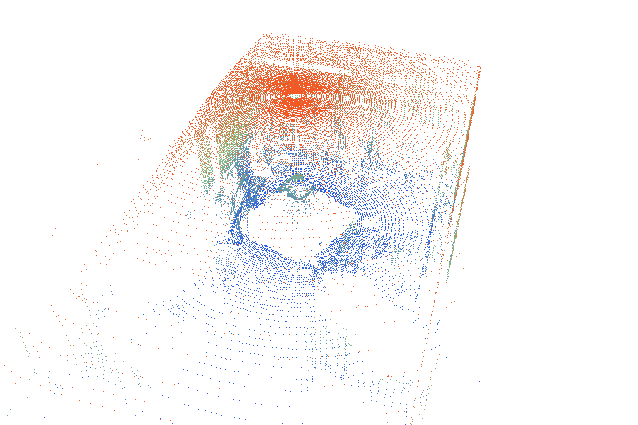
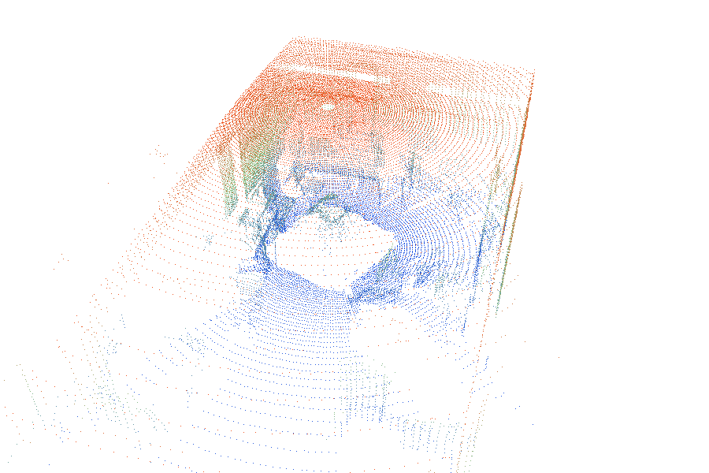
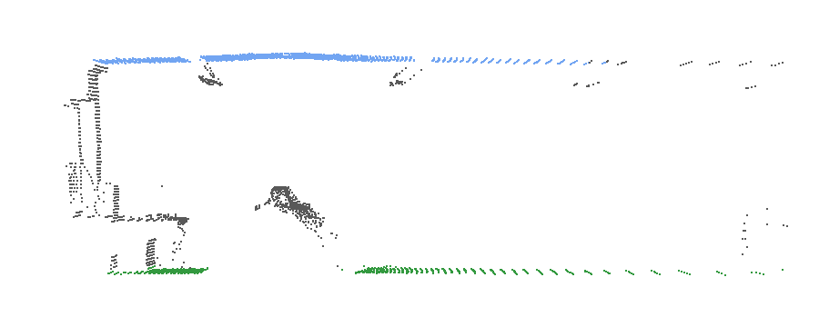
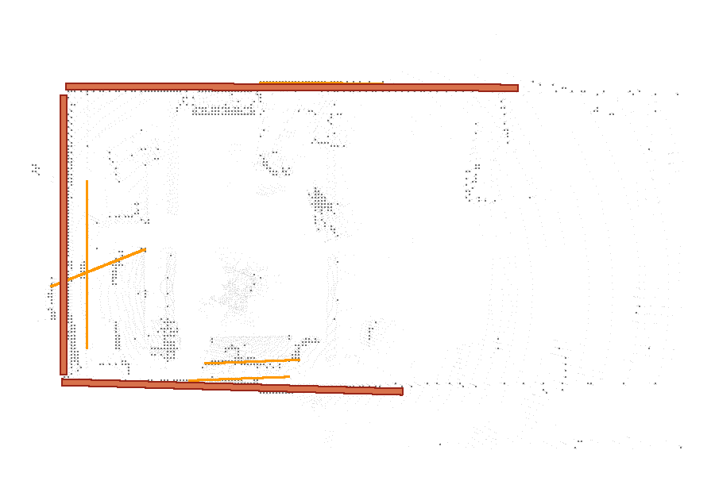
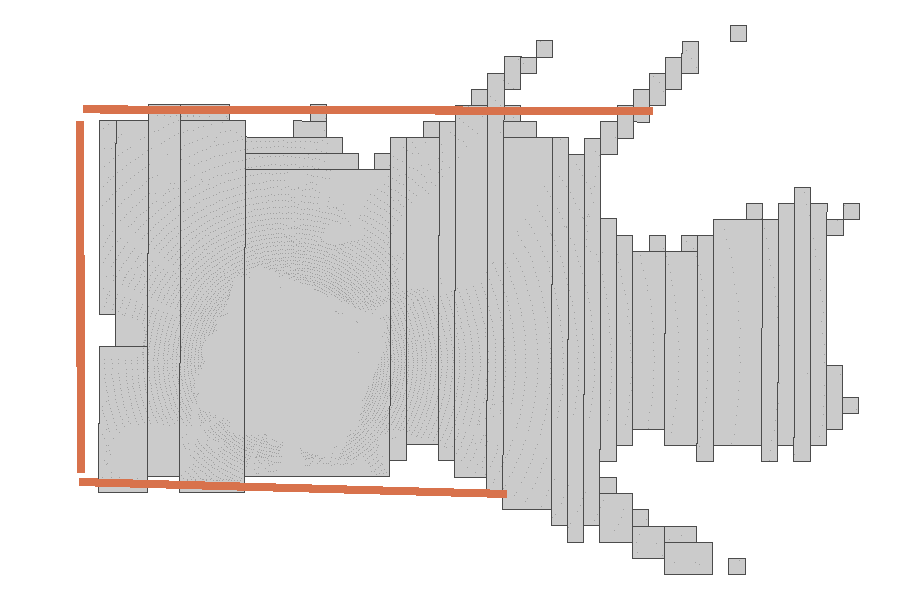
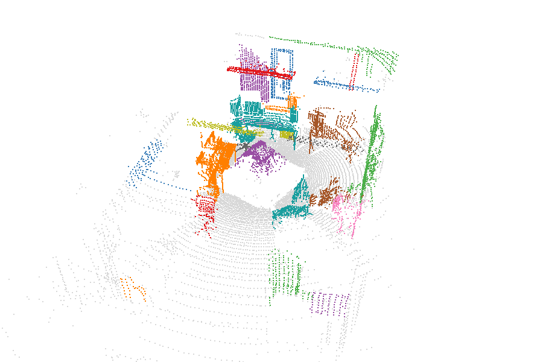
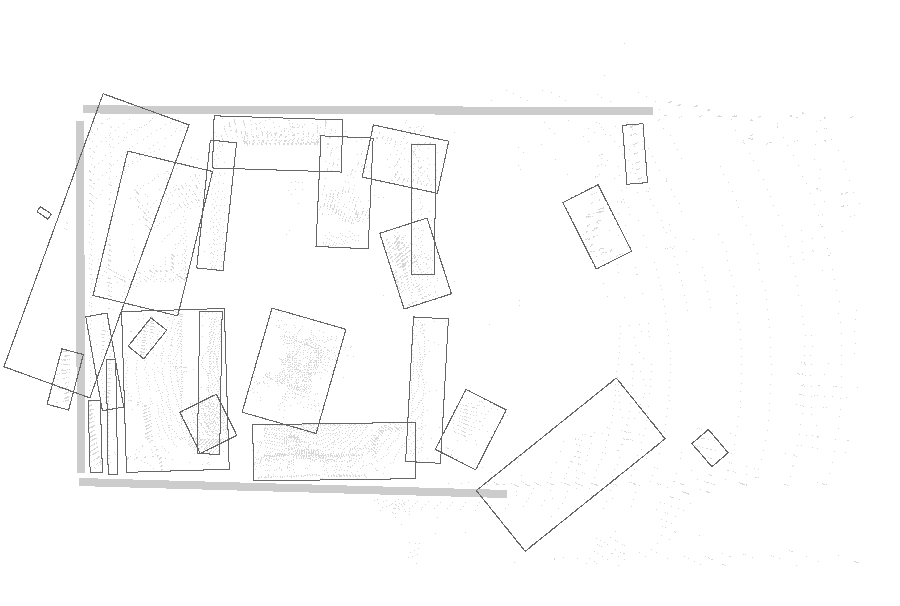
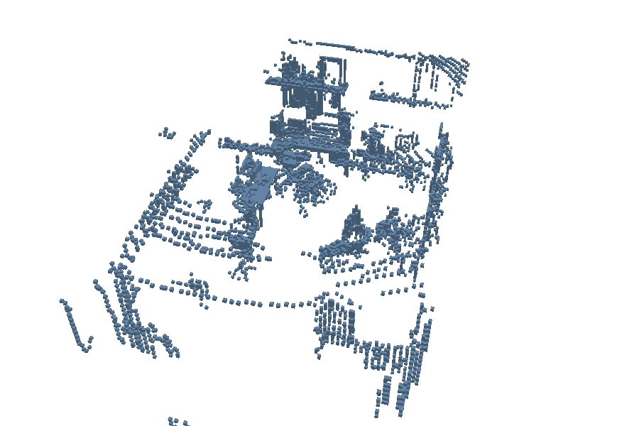
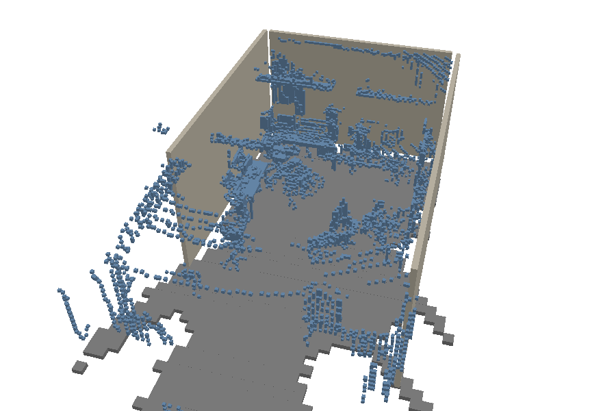
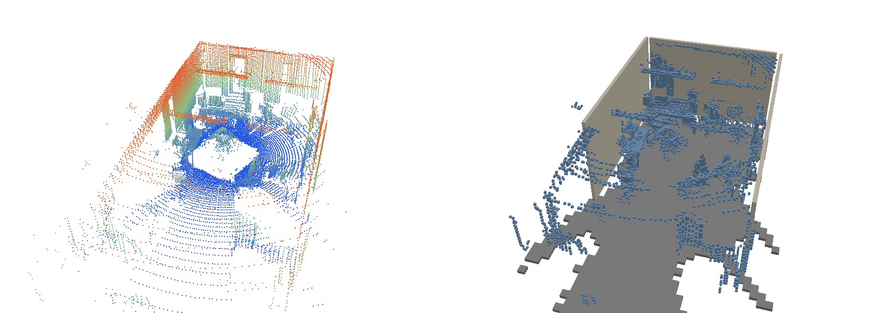

# PCL 房間掃描

Point Cloud Library 資料庫的 `tutorials/room_scan1.pcd`（BSD-3-Clause，commit `084fa0e`）：一間約 7 m x 4.6 m 的辦公室，一側開向走廊，11 萬 2586 點，`binary_compressed` 編碼。檔案不放在本 repo，`harness/run.sh demo-room` 執行時下載並核對 SHA-256 `52c373a6…`。

和兩個合成場景不同，這是旋轉式光達的真實掃描：近處密、遠處疏，地面被家具擋住一大半，家具彼此相連、也沒有固定尺寸。這個範例看的是十個步驟在這種資料上各自的表現。

| 輸入點雲 | 匯出的 USD |
| --- | --- |
|  |  |

## 執行

```bash
harness/run.sh demo-room            # 下載、還原、驗收，輸出在 out/room_scan/scene/
```

harness 先下載點雲到 `data/room_scan1.pcd`（已存在且雜湊相符就略過），再執行：

```bash
pcd2scene build  data/room_scan1.pcd -c examples/room_scan/config.yaml -o out/room_scan/scene --stages
pcd2scene accept out/room_scan/scene examples/room_scan/accept.json --json out/room_scan/scene/accept.json
```

| 指令 | 輸入 | 輸出 |
| --- | --- | --- |
| `build` | `room_scan1.pcd`、[config.yaml](config.yaml) | `scene/` 下的 `scene.json`、`scene.urdf`、`scene.sdf`、`scene.usda`、`meshes/residual.stl`、`report.json`、`stages/` 等 |
| `accept` | `scene/`、[accept.json](accept.json) | `accept.json`：ACCEPT |

真實資料沒有真值，所以沒有 `compare`，驗收只看數量、高度與覆蓋率。設定檔只改三處：

```yaml
objects:
  unknown: mesh                              # 不放目錄，叢集全部進殘餘網格
input:
  crop: [-4.0, -2.5, -2.0, 7.0, 4.0, 3.0]    # 只留房間與門外走廊，裁掉窗外的稀疏點
preview:
  azimuth_deg: 15                            # 相機從開口那一側看進去
  elevation_deg: 40
```

## 逐步結果

每一步的圖都在 `out/room_scan/scene/stages/`，數字在同目錄的 `stages.json`。每一步的原理見[逐步教學](../../docs/tutorial.md)。

### 1、2. 讀檔與體素平均

輸入：`room_scan1.pcd` 112,586 點，`input.crop` 之後剩 108,780 點。輸出：體素平均後 35,718 點，只剩三分之一。

原始點雲有掃描器特有的同心圓紋路：掃描器附近的點擠在一起，遠處稀疏。體素平均把擠在一起的點合併，遠處的點保留，各區域的點數才接近面積比例，後面的 RANSAC 與填滿率才不會偏向掃描器附近：

| 原始（108,780 點） | 體素平均（35,718 點） |
| --- | --- |
|  |  |

### 3. 地面、天花板、轉正

輸入：35,718 點。RANSAC 找到四個水平面：

| 平面 | 點數 | 在點雲中心的高度（輸入座標） | 判定 |
| --- | --- | --- | --- |
| 1 | 9,125 | 1.659 m | 天花板 |
| 2 | 5,519 | −1.273 m | 最低：地面 |
| 3 | 1,274 | −0.565 m | 離地約 0.7 m，桌面的高度 |
| 4 | 1,038 | 1.678 m | 和天花板同高 |

點最多的平面是天花板。地面被桌椅擋住，點數只有天花板的六成，所以程式選「最低的水平面」當地面，不選「最大的」。

輸出：傾角 1.04 度的轉正、天花板離地 2.95 m。5,756 點標成 floor，11,328 點標成 ceiling。剖面裡綠色是地面、藍色是天花板：



### 4. 牆

輸入：還沒標記的點與天花板高度 2.95 m。高格子 1,101 個，找出八條候選：

| 候選 | 長度 | 頂高 | 填滿率 | 結果 |
| --- | --- | --- | --- | --- |
| 三面牆 | 7.05、5.30、4.35 m | 2.95 m | 0.39、0.49、0.44 | 牆 |
| 家具、隔板 | 1.50 到 2.65 m | 0.76 到 2.41 m | 0.37 到 0.60 | 拒絕：碰不到天花板（其中兩條也太矮） |
| 另一條家具候選 | 1.62 m | 2.74 m | 0.17 | 拒絕：填滿率低 |

三面真牆的填滿率只有 0.39 到 0.49，下半部被家具擋住，但仍高於門檻 0.33。家具的候選填滿率反而比較高（最高 0.60），靠的是頂高與天花板接觸條件排除。第四側是走廊開口，沒有牆。

輸出：3 面牆，牆高拉到天花板。紅色是牆，橘線是被拒絕的候選：



### 5. 地面板

輸入：floor 點與最長那面牆的方向。輸出：59 塊矩形板，共 37.32 m²。地面形狀不規則：右側走廊離掃描器遠、點稀疏，邊緣呈階梯狀，房間裡也有家具底下沒補滿的缺口，所以分成很多板。紅線是牆：



### 6. 分群

輸入：拿掉地面、天花板、牆之後的點。輸出：25 群。桌子、椅子、櫃子彼此靠著，常連成同一群；走廊的零星點也各自成群：



### 7. 比對目錄

輸入：25 個叢集，目錄是空的。輸出：沒有物件元素，25 個叢集都依 `objects.unknown: mesh` 留給下一步。下圖的框是每群的佔地矩形，大小、方向都不規則，這也是不放目錄的原因：



要給機器人一組簡化的碰撞體，可以改成 `objects.unknown: box`，每個叢集輸出一個外接盒（類別 `unknown`）。

### 8. 殘餘網格

輸入：還沒標記的 10,054 點，主要是家具與走廊。其中 511 點屬於連通後不到 10 點的小叢集，標成 outlier，不建模。其餘 9,543 點轉成 `meshes/residual.stl`，共 38,012 個三角形。

圖上排成弧形的點列離地約 2.58 m，在天花板（2.95 m，`ceiling.band` 8 cm）下方約 0.37 m，是另一層水平結構的掃描線。它們連成一串，不算零星點，所以留在網格裡：



### 9、10. 場景與匯出

`scene.json` 有 6 個元素：地面、天花板、3 面牆、殘餘網格。天花板預設不匯出，其餘 5 個匯出。三張圖都只畫匯出的元素，三角形都是 38,756 個：

| scene.json | scene.urdf | scene.usda |
| --- | --- | --- |
|  |  |  |

## 結果

| 項目 | 結果 |
| --- | --- |
| 地面 | 輸入傾斜 1.04 度，轉正後在 z = 0 |
| 天花板 | 離地 2.95 m（預設不輸出） |
| 牆 | 3 面；第四側是走廊開口 |
| 家具 | 彼此相連、沒有固定尺寸，留在殘餘網格 |
| 點的歸屬 | floor 5,756、ceiling 11,328、wall 8,580、residual 9,543、outlier 511 |
| 覆蓋率 | 輸入點離場景表面 5 cm 內 92.9%，10 cm 內 100%（outlier 不計） |



驗收規格 [accept.json](accept.json)：一塊地面、至少三面牆、天花板高 2.7 到 3.2 m、地面傾角 2 度內、覆蓋率在 0.05 m 內 0.9 以上且 0.1 m 內 0.99 以上。

同一間房間的另一次掃描見 [room_scan2](../room_scan2/README.md)。
