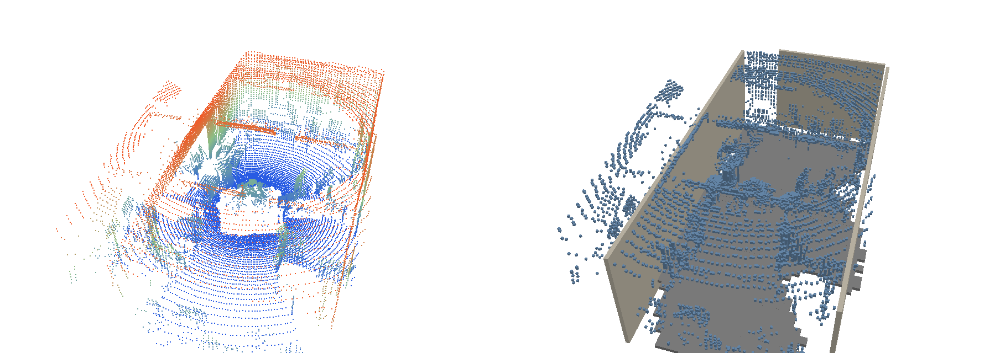

# PCL 房間掃描（第二次）

Point Cloud Library 資料庫的 `tutorials/room_scan2.pcd`（BSD-3-Clause，commit `084fa0e`）：和 [room_scan](../room_scan/README.md) 同一間辦公室，掃描器換了位置與方向，11 萬 2624 點，`binary_compressed` 編碼。`harness/run.sh demo-room2` 執行時下載並核對 SHA-256 `c7138761…`。

```bash
harness/run.sh demo-room2           # 輸出在 out/room_scan2/scene/，各步驟的圖在 stages/
```

設定 [config.yaml](config.yaml) 示範兩件事。

**先轉正再裁切。** 這次掃描的座標相對第一次轉了約 40 度，軸對齊的裁切框框不乾淨。`input.transform` 用 PCL NDT 教學程式（`normal_distributions_transform.cpp`）給的初始估計：繞 z 轉 0.6931 rad、平移 (1.79387, 0.720047, 0)。轉過去之後沿用 room_scan 的裁切範圍。這組估計來自里程計，NDT 會再精修，所以不是精確對位，只用來把房間擺正。

**依被拒絕的候選調整牆的門檻。** 用預設設定跑，log 裡兩面長牆被拒絕：

```text
wall candidate rejected: length 9.55 top 2.88 fill 0.26 upper 0.41 contact True
wall candidate rejected: length 9.40 top 2.87 fill 0.29 upper 0.45 contact True
```

長度、高度都夠，也碰得到天花板，只差填滿率低於預設的 0.33：這次掃描器站的位置讓長牆被家具擋得較多。其他候選的填滿率是 0.15 到 0.19，或碰不到天花板。設定把 `walls.min_fill` 降到 0.24，夾在兩群之間，兩面長牆通過，家具與隔板仍被拒絕。調整前後的候選與結果可以在 `stages/04_walls.png` 對照。

| 項目 | 結果 |
| --- | --- |
| 地面 | 轉正後傾斜 1.72 度（room_scan1 是 1.04 度，兩次掃描的感測器姿態不同） |
| 天花板 | 離地 2.96 m（room_scan1 是 2.95 m） |
| 牆 | 3 面 |
| 覆蓋率 | 輸入點離場景表面 5 cm 內 90.1%，10 cm 內 100% |



驗收規格 [accept.json](accept.json)：一塊地面、至少三面牆、天花板 2.7 到 3.2 m、地面傾角 2.5 度內、覆蓋率在 0.05 m 內 0.85 以上且 0.1 m 內 0.99 以上。
