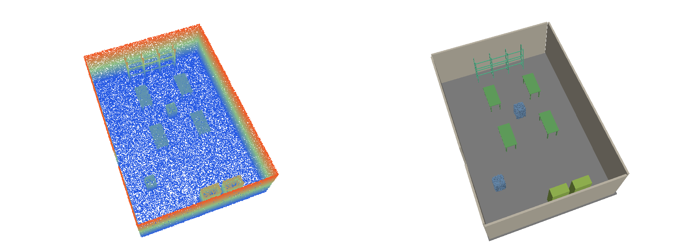

# 合成辦公室

`pcd2scene synth --layout office` 產生的 10 m x 7 m 辦公室：2.8 m 天花板、四面牆（南牆留 1 m 門口）、四張辦公桌、靠東牆兩個櫃子、靠西牆一排三格的書架，以及兩個不在目錄裡、椅子大小的箱子。整體再傾斜約 0.7 度、旋轉 −40 度並平移。真值在 `truth.json`，物件目錄與預覽角度在 `catalog.yaml`。

```bash
harness/run.sh demo-office          # 輸出在 out/synth_office/scene/，各步驟的圖在 stages/
```

和合成倉庫相比，這個場景多測三件事：

- 天花板：偵測到 2.7996 m（真值 2.8 m），牆高拉到天花板。
- 牆的天花板接觸條件：兩個並排的櫃子（頂高 1.8 m）與書架（頂高約 1.95 m）在牆偵測時都形成長度 2 到 3 m 的候選，因為碰不到天花板而被拒絕。
- 同一目錄多種類別：辦公桌用 `table` 模型、櫃子用 `box`、書架用 `rack` 模型加 `levels: auto`（偵測到 0.72、1.42 m，真值 0.7、1.4 m）。

| 項目 | 結果 |
| --- | --- |
| 地面 | 真值地面四角還原後離 z = 0 最多 0.4 mm |
| 牆 | 5/5，中心誤差最大 6.3 cm（只看到內側面，牆盒用預設厚度 0.1 m，真值 0.15 m），方向誤差 0.3 度內 |
| 物件 | 辦公桌 4/4、櫃子 2/2、書架 1/1（3 格），中心誤差 7 mm 內、方向誤差 0.9 度內 |
| 未登錄的箱子 | 留在殘餘網格 |
| 覆蓋率 | 5 cm 與 10 cm 內都是 100% |



驗收規格 [accept.json](accept.json)：`compare.pass`（含天花板高度差 5 cm 內）、各類別數量、地面傾角 0.6 到 0.85 度、天花板 2.75 到 2.85 m、覆蓋率門檻。
