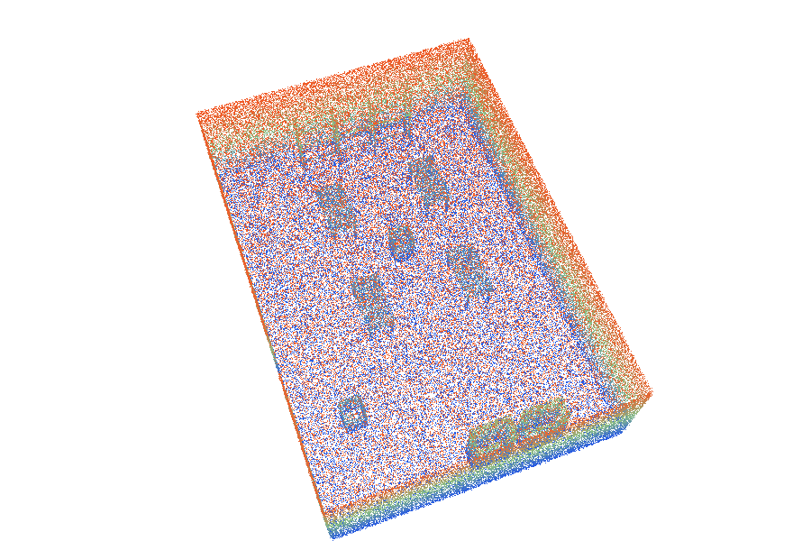
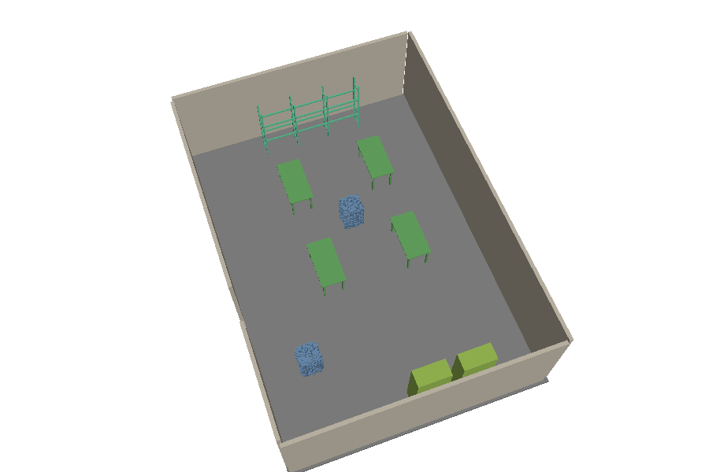
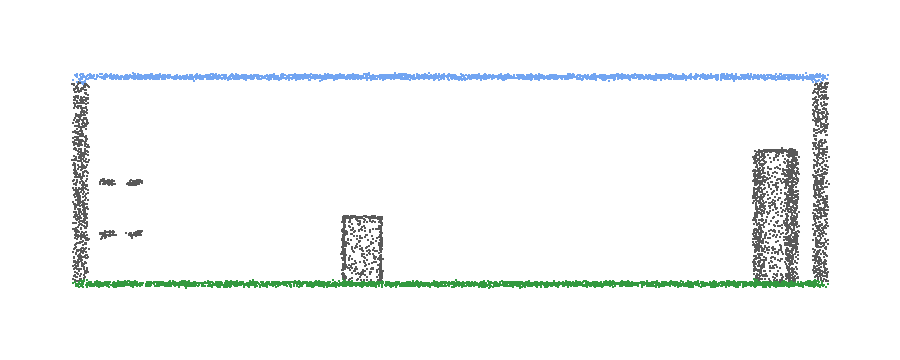
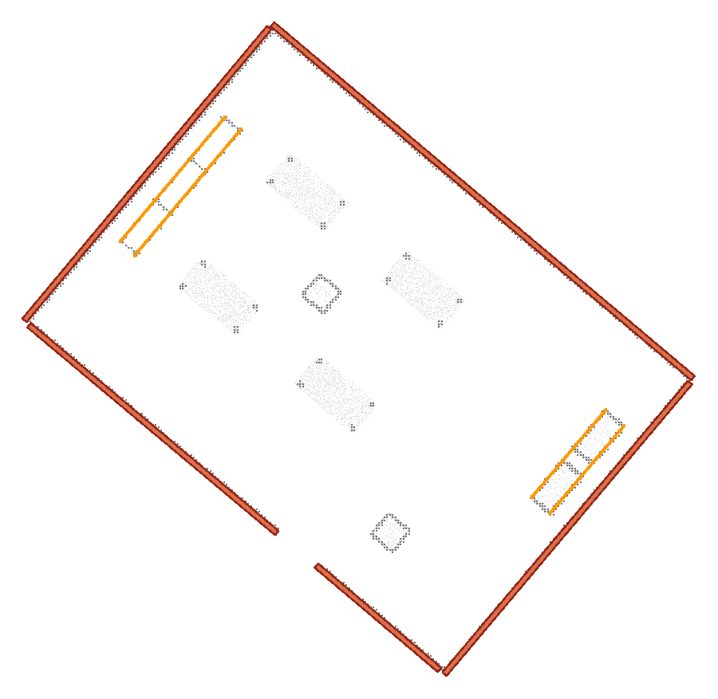
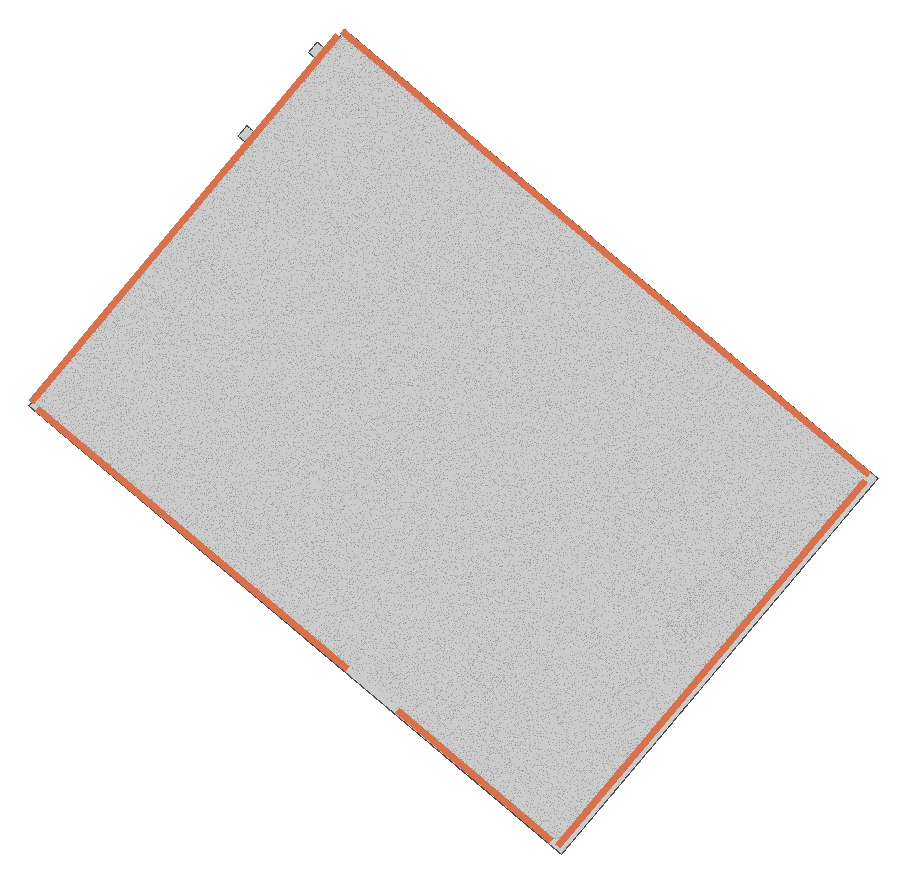
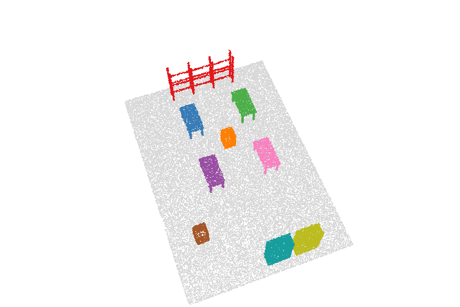
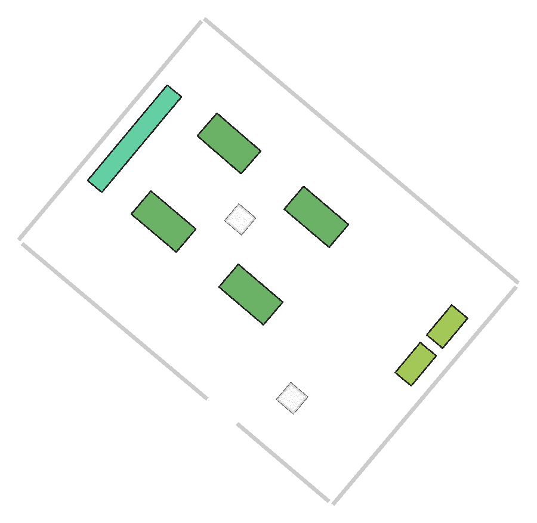
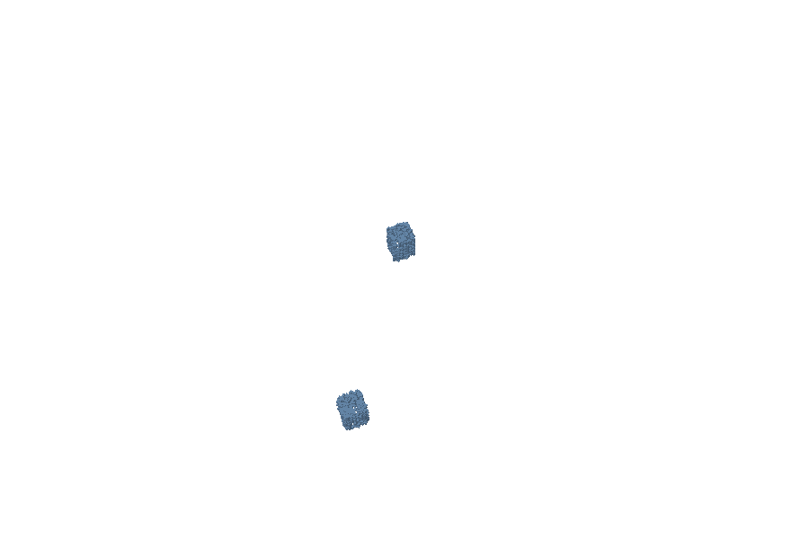

# 合成辦公室

`pcd2scene synth --layout office` 產生的 10 m x 7 m 辦公室：2.8 m 天花板、四面牆（南牆留 1 m 門口）、四張辦公桌、靠東牆兩個櫃子、靠西牆一排三格的書架，以及兩個不在目錄裡、椅子大小的箱子。整體再傾斜約 0.7 度、旋轉 −40 度並平移。

和[合成倉庫](../../docs/tutorial.md)相比，這個場景有天花板。天花板讓第 3 步多一個要分辨的水平面，也讓第 4 步多一個判斷牆的條件：牆頂要碰到天花板。

| 輸入點雲 | 匯出的 USD |
| --- | --- |
|  |  |

## 執行

```bash
harness/run.sh demo-office          # 全部步驟加驗收，輸出在 out/synth_office/
```

harness 依序執行下面四個指令，也可以自己逐一下（native 模式把 `pcd2scene` 換成 `.venv/bin/python -m pcd2scene`）：

```bash
pcd2scene synth   out/synth_office/data --layout office
pcd2scene build   out/synth_office/data/office.pcd -c out/synth_office/data/catalog.yaml -o out/synth_office/scene --stages
pcd2scene compare out/synth_office/scene/scene.json out/synth_office/data/truth.json --out out/synth_office/scene/compare.json
pcd2scene accept  out/synth_office/scene examples/synth_office/accept.json --json out/synth_office/scene/accept.json
```

| 指令 | 輸入 | 輸出 |
| --- | --- | --- |
| `synth` | 無 | `office.pcd`（164,882 點）、`truth.json`、`catalog.yaml`（三類家具與預覽角度） |
| `build` | `office.pcd`、`catalog.yaml` | `scene/` 下的 `scene.json`、`scene.urdf`、`scene.sdf`、`scene.usda`、`meshes/residual.stl`、`report.json`、`stages/` 等 |
| `compare` | `scene.json`、`truth.json` | `compare.json`：牆 5/5、物件 7/7、天花板高度差 0.4 mm，PASS |
| `accept` | `scene/`、[accept.json](accept.json) | `accept.json`：ACCEPT |

各指令的選項與輸出檔格式見 [docs/commands.md](../../docs/commands.md)。物件目錄是 `synth` 寫出的 `catalog.yaml`，三個類別用三種模型：

```yaml
objects:
  catalog:
  - class: desk
    size: [1.4, 0.7, 0.74]
    tolerance: [0.15, 0.1, 0.06]
    model: {type: table, top_thickness: 0.03}
  - class: cabinet
    size: [0.9, 0.45, 1.8]
    tolerance: [0.1, 0.08, 0.1]
    model: {type: box}
  - class: shelf
    size: [1.0, 0.4, 2.0]
    array: {pitch: 1.0}
    model: {type: rack, levels: auto}
```

（實際檔案還有書架的容許誤差、立柱與橫樑尺寸，以及預覽角度，這裡省略。）

## 逐步結果

每一步的圖都在 `out/synth_office/scene/stages/`，數字在同目錄的 `stages.json`。每一步的原理見[逐步教學](../../docs/tutorial.md)，這裡寫辦公室的輸入、輸出與不同之處。

### 1、2. 讀檔與體素平均

輸入 `office.pcd` 164,882 點，體素平均後剩 138,047 點。從上方看，最先看到的是天花板的點，所以上面的輸入圖幾乎只看得到天花板。室內的家具要等第 3 步分出天花板之後才看得清楚。


### 3. 地面、天花板、轉正

輸入：138,047 點。RANSAC 找到四個水平面：

| 平面 | 點數 | 在點雲中心的高度（輸入座標） | 判定 |
| --- | --- | --- | --- |
| 1 | 37,672 | −1.101 m | 最低：地面 |
| 2 | 37,343 | 1.699 m | 比地面高 2.8 m：天花板 |
| 3、4 | 3,115、3,420 | −0.368、−0.289 m | 桌面，離地不到 1.8 m，不算天花板 |

輸出：傾角 0.72 度的轉正、天花板離地 2.7996 m（真值 2.8 m）。38,310 點標成 floor，38,298 點標成 ceiling。

剖面是沿最長那面牆方向切的 0.5 m 薄片。綠色是地面、藍色是天花板，兩端是牆。中間的方塊是一個未登錄的箱子（高 0.9 m），右邊是櫃子（高 1.8 m），左邊兩組短橫線是書架在 0.7、1.4 m 的橫樑：



### 4. 牆

輸入：還沒標記的點與天花板高度 2.8 m。高格子 1,684 個，找出九條候選：

| 候選 | 長度 | 頂高 | 填滿率 | 結果 |
| --- | --- | --- | --- | --- |
| 四面牆（南牆被門口分成兩段） | 2.96 到 10.09 m | 2.80 m | 0.97 到 1.00 | 牆 |
| 兩個並排櫃子的前後兩面 | 2.18 m | 1.79、1.80 m | 0.91 | 拒絕：頂高不到 1.8 m，也碰不到天花板 |
| 書架的一面 | 3.10 m | 1.96 m | 0.30 | 拒絕：填滿率低，也碰不到天花板 |
| 書架的另一面 | 3.07 m | 1.94 m | 0.36 | 拒絕：碰不到天花板 |

最後一行是這個場景的重點。這一面的填滿率 0.36 高於門檻 0.33，長度與高度也都過關，只靠「牆頂要離天花板 0.4 m 內」（`walls.ceiling_contact`）排除。沒有天花板的場景沒有這個條件可用。

輸出：5 面牆，牆高拉到天花板。紅色是牆，橘線是被拒絕的候選：



### 5. 地面板

輸入：floor 點與最長那面牆的方向。輸出：3 塊矩形板，共 73.52 m²。天花板用同樣的方法做成板，預設不匯出（`ceiling.export: false`），免得從上方看不到室內：



### 6. 分群

輸入：拿掉地面、天花板、牆之後的點。輸出：9 群，正好是 4 張桌子、2 個櫃子、1 排書架、2 個箱子：



### 7. 比對目錄

輸入：9 個叢集與上面的目錄。每群量到的佔地矩形與高度：

| 叢集 | 量到的長 x 寬 x 高 | 對上的類別 |
| --- | --- | --- |
| 4 張桌子 | 1.42 到 1.45 x 0.73 到 0.74 x 0.76 m | desk（目錄 1.4 x 0.7 x 0.74） |
| 2 個櫃子 | 0.96 x 0.51 x 1.81 m | cabinet（目錄 0.9 x 0.45 x 1.8） |
| 書架 | 3.05 x 0.45 x 1.98 m | shelf，3 格：(3 − 1) x 1.0 + 1.0 = 3.0 m |
| 2 個箱子 | 約 0.5 x 0.5 x 0.9 m | 沒有，留給下一步 |

量到的長寬比目錄略大，因為點帶 1 cm 雜訊，佔地矩形又是包住所有點的最小矩形；差距都在容許誤差內。書架的層板高度從點的高度分布找出來，是 0.72 與 1.42 m（真值 0.7、1.4 m）。

輸出：7 個物件元素。填色的是對上的，只有框的是沒對上的：



### 8. 殘餘網格

輸入：兩個箱子的 2,029 點。輸出：`meshes/residual.stl`，5,674 個三角形：同一平面上相鄰的體素面合併成矩形，形狀和逐面輸出相同：



### 9、10. 場景與匯出

`scene.json` 有 15 個元素：地面、天花板、5 面牆、7 個家具、殘餘網格。天花板標了 `"export": false`，其餘 14 個匯出。三張圖都只畫匯出的元素，三角形都是 6,466 個：

| scene.json | scene.urdf | scene.usda |
| --- | --- | --- |
|  |  |  |

## 結果

| 項目 | 結果 |
| --- | --- |
| 地面 | 真值地面四角還原後離 z = 0 最多 0.4 mm |
| 天花板 | 2.7996 m（真值 2.8 m） |
| 牆 | 5/5，中心誤差最大 6.3 cm（只看到內側面，牆盒用預設厚度 0.1 m，真值 0.15 m），方向誤差 0.3 度內 |
| 物件 | 辦公桌 4/4、櫃子 2/2、書架 1/1（3 格），中心誤差 7 mm 內、方向誤差 0.9 度內 |
| 未登錄的箱子 | 留在殘餘網格 |
| 點的歸屬 | floor 38,310、ceiling 38,298、wall 46,425、object 12,985、residual 2,029 |
| 覆蓋率 | 5 cm 與 10 cm 內都是 100% |


驗收規格 [accept.json](accept.json)：`compare.pass`（含天花板高度差 5 cm 內）、各類別數量、地面傾角 0.6 到 0.85 度、天花板 2.75 到 2.85 m、覆蓋率門檻。
