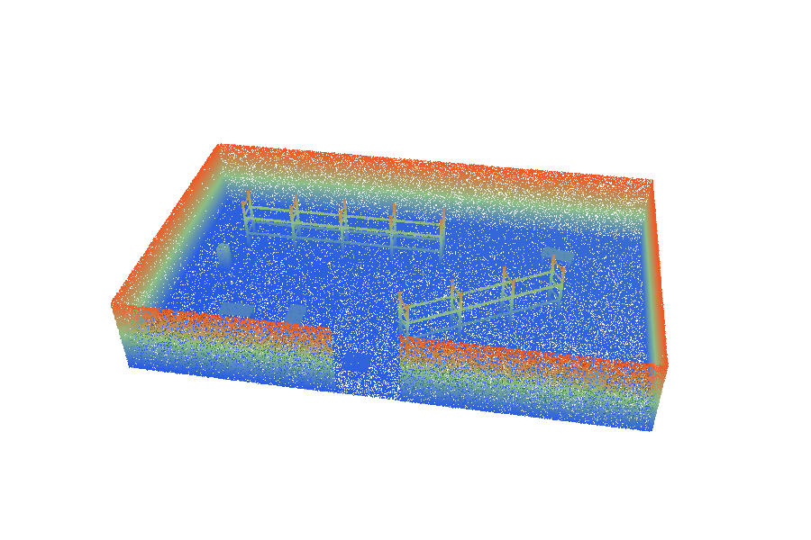
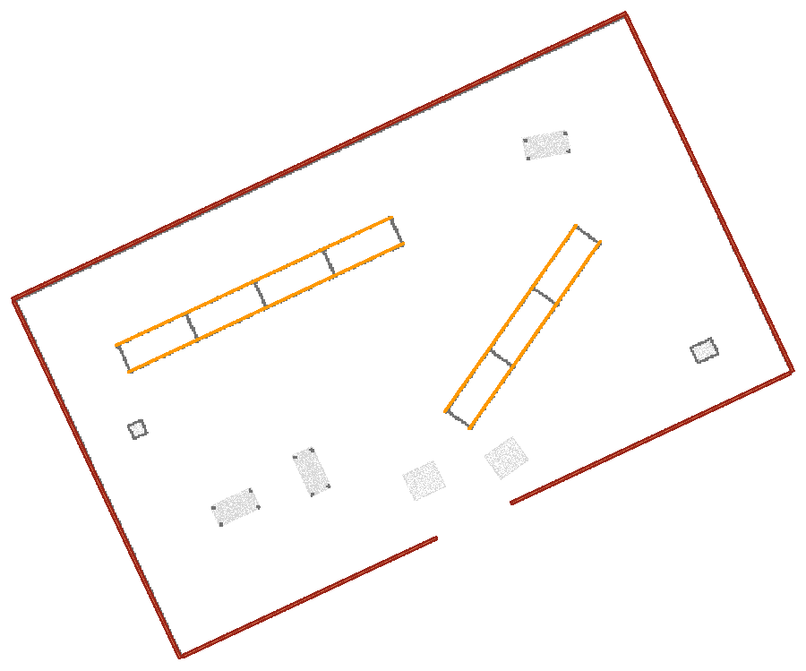
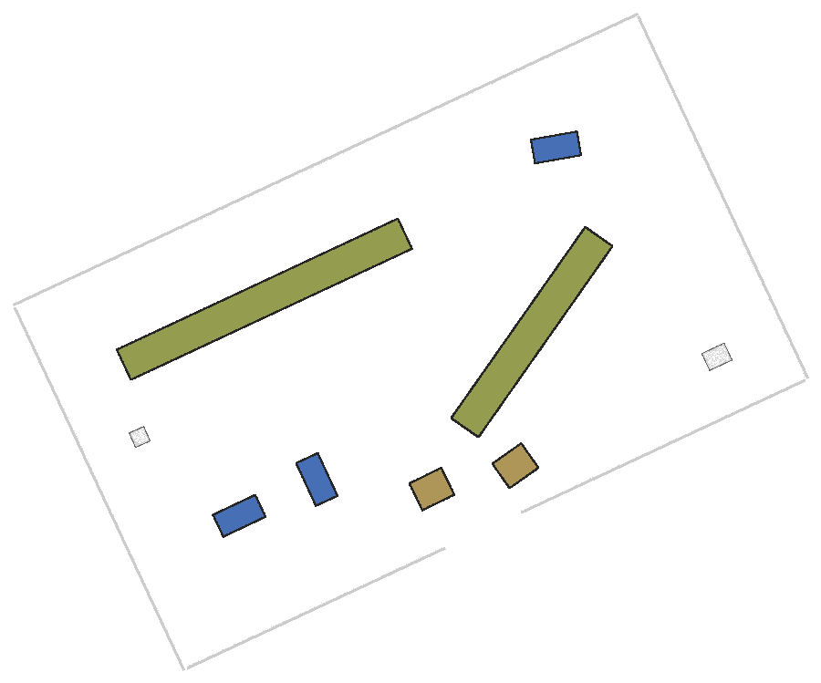
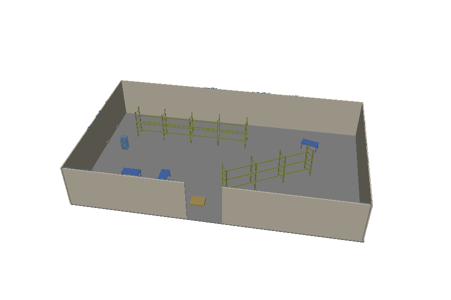

# 合成倉庫

`pcd2scene synth` 產生的 24 m x 14 m 倉庫：四面牆（南牆留 3 m 門口）、兩排貨架（4 格與 3 格，其中一排轉 30 度）、三張桌子、兩個棧板，以及兩個不在目錄裡的箱子。整體再加 0.9 度傾斜、25 度旋轉與平移。附真值，可以逐項比對。

這個場景的每一步都寫在[逐步教學](../../docs/tutorial.md)，從 PCD 檔頭、每一步的圖，到 `scene.json`、URDF 與 USD 的實際片段。

| 原始點雲 | 牆（紅）與被拒絕的貨架正面（橘） |
| --- | --- |
|  |  |
| **比對物件目錄** | **從 scene.usda 讀回** |
|  |  |

## 執行

```bash
harness/run.sh demo-synth           # 輸出在 out/synth_warehouse/
```

| 指令 | 輸入 | 輸出 |
| --- | --- | --- |
| `synth out/synth_warehouse/data` | 無 | `warehouse.pcd`（436,132 點）、`truth.json`、`catalog.yaml` |
| `build … --stages` | `warehouse.pcd`、`catalog.yaml` | `out/synth_warehouse/scene/`（`scene.json`、三種格式、`report.json`、`stages/` 等） |
| `compare` | `scene.json`、`truth.json` | `compare.json`：牆 5/5、物件 7/7，PASS |
| `accept` | `scene/`、[accept.json](accept.json) | `accept.json`：ACCEPT |

完整指令與每個輸出檔的格式見 [docs/commands.md](../../docs/commands.md)。

## 結果

| 項目 | 結果 |
| --- | --- |
| 地面 | 真值地面四角還原後離 z = 0 最多 0.2 mm |
| 牆 | 5/5，中心誤差最大 7.7 cm（只看到內側面，牆盒用預設厚度 0.1 m，真值是 0.2 m），方向誤差 0.12 度內 |
| 貨架 | 2/2，格數 4 與 3 正確，自動偵測的層板高度 1.02、2.02 m（真值 1.0、2.0 m） |
| 桌子、棧板 | 3/3、2/2；所有目錄物件的中心誤差 6 mm 內、方向誤差 1 度內 |
| 未登錄的箱子 | 留在殘餘網格 |
| 點的歸屬 | floor 180,701、wall 151,644、object 30,349、residual 3,189、outlier 467（牆頂邊緣的雜點） |
| 覆蓋率 | 5 cm 內 99.90%，10 cm 內 100% |

驗收規格 [accept.json](accept.json)：`compare.pass`、各類別數量、地面傾角 0.9 到 1.0 度、沒有天花板、覆蓋率門檻。`compare.pass` 表示真值地面四角還原後離 z = 0 在 3 cm 內，每面牆與每個物件都在真值的 0.2 m、3 度內，牆長差 0.4 m 內，貨架的格數相同、層板高度差 0.05 m 內。
